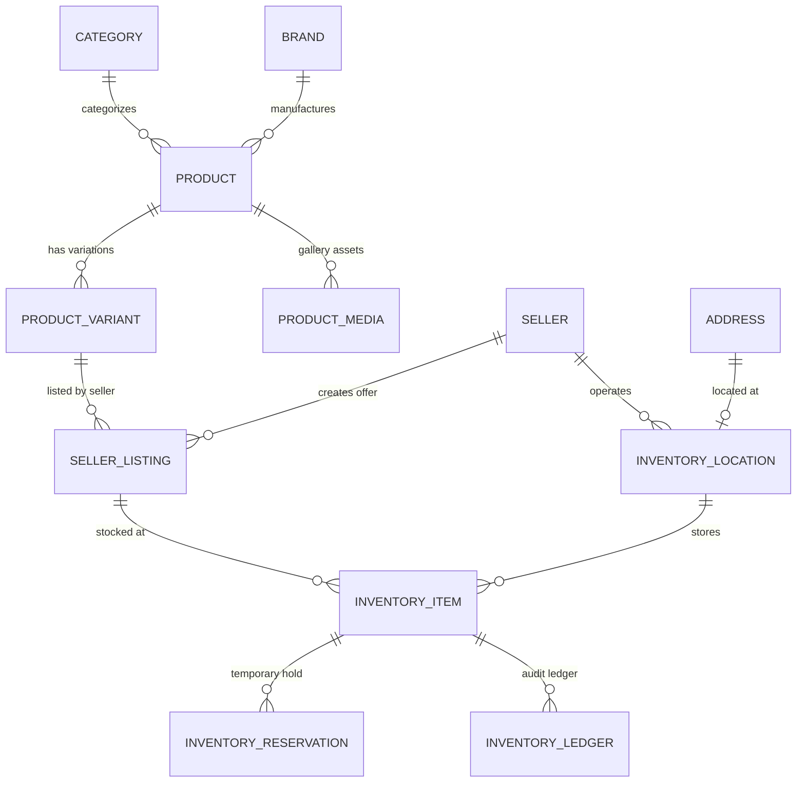
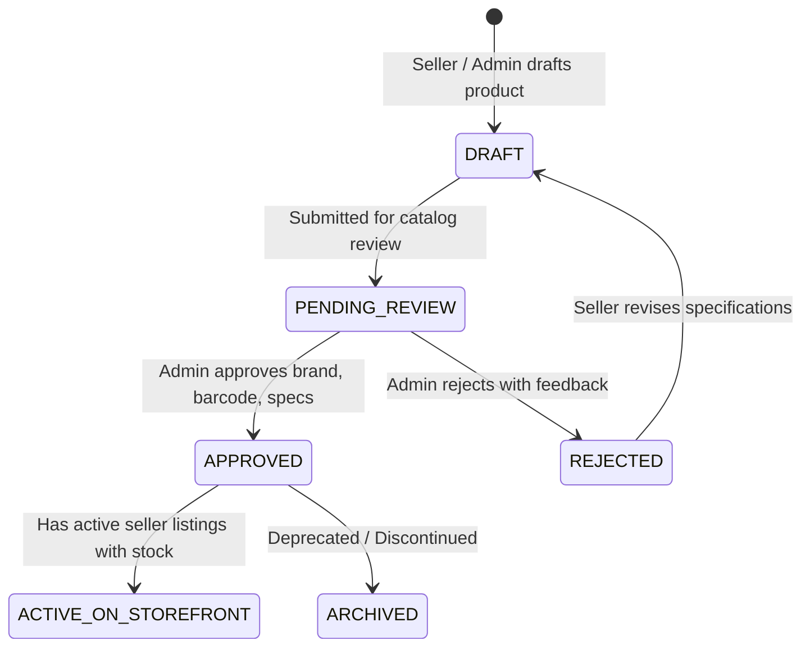

# ADR 0005: Master Catalog (SPU/SKU), Seller Listing (Offer), and Multi-Warehouse Double-Entry Inventory Ledger

* **Status**: Accepted
* **Date**: 2026-11-03

---

## Context

In an enterprise multi-vendor marketplace (comparable to Amazon, Flipkart, or Walmart):
1. **Catalog Deduplication**: Multiple sellers often sell the identical physical product (e.g., iPhone 15 Pro, Nike Air Max). Forcing each seller to build an isolated product listing produces duplicate product records, fragmented customer reviews, conflicting search rankings, and poor buyer discovery.
2. **Quality & Brand Protection**: Catalog additions must undergo admin review (matching brand authorization, accurate taxonomy, GTIN barcode validation, and verified specifications) before going live on the storefront.
3. **Inventory Race Conditions & Multi-Warehouse Fulfillment**:
   - Simple single-integer `stock` columns on product rows fail in production: they cause overselling during concurrent checkouts, cannot represent multi-location fulfillment (seller warehouses, retail pickup, central fulfillment centers), and offer no forensic audit trail for lost, damaged, or returned stock.
   - Setting up multi-warehouse architectures later requires costly, disruptive schema rewrites and data migrations. Starting with multi-warehouse support from V1 future-proofs the inventory engine.

---

## Decision

We will implement a two-tier Catalog Architecture combined with a Multi-Warehouse Double-Entry Inventory Engine:

### 1. Catalog Tier: Master Product (SPU) & Canonical Variant (SKU)
- **`Brand`**: Registered brands with logo, verification status, and metadata.
- **`Product` (SPU)**: The canonical catalog definition. Stores the canonical title, brand, category hierarchy, rich markdown descriptions, technical specifications JSON, and moderation status (`DRAFT`, `PENDING_REVIEW`, `APPROVED`, `REJECTED`, `ARCHIVED`).
- **`ProductVariant` (SKU)**: Specific canonical variations (e.g., Color, Size, Storage). Stores standardized option attributes, GTIN/EAN/UPC barcodes, and physical dimensions/weight.
- **`ProductMedia`**: Multi-asset gallery mapping canonical images and videos to products and specific variants with display ordering.

### 2. Marketplace Tier: Seller Listing (Offer)
- **`SellerListing`**: A seller's commercial offer for a specific `ProductVariant`. Holds the seller's internal SKU (`sellerSku`), pricing (`mrpPrice`, `sellingPrice`), currency, item condition (`NEW`, `REFURBISHED`, `USED`), handling lead time, warranty details, and active selling state (`ACTIVE`, `INACTIVE`, `SUSPENDED`).
- Enables single-PDP customer experiences with **Buy Box** selection and multi-seller comparison.

### 3. Inventory Tier: Multi-Warehouse & Double-Entry Ledger
- **`InventoryLocation`**: Physical stock locations (Seller Warehouses, Dropship Depots, Platform Fulfillment Centers). Links to a normalized `Address`.
- **`InventoryItem`**: Represents stock for a specific `SellerListing` at a specific `InventoryLocation`. Tracks:
  - `onHand`: Total physical items present in the warehouse.
  - `reserved`: Items locked during active checkout (with TTL).
  - `available`: Calculated as `onHand - reserved`.
  - `safetyStock`: Buffer threshold below which items show out-of-stock to prevent overselling.
  - `lowStockThreshold`: Seller alert trigger.
- **`InventoryReservation`**: Temporary holds created during cart checkout (`PENDING`, `COMMITTED`, `RELEASED`, `EXPIRED`) with expiry timestamp.
- **`InventoryLedger`**: Immutable append-only audit trail logging every stock delta (`RESTOCK`, `ORDER_RESERVED`, `ORDER_FULFILLED`, `ORDER_CANCELLED_RESTOCK`, `RETURN_RESTOCK`, `DAMAGE_WRITEOFF`, `INVENTORY_AUDIT_ADJUSTMENT`, `TRANSFER`) with snapshot of balance after transaction.

---

## Architecture Diagram

---

## Product Moderation State Machine

---

## Inventory Reservation & Concurrency Strategy

1. **Reservation on Checkout**:
   - When a buyer clicks "Proceed to Checkout", the system creates an `InventoryReservation` with a 15-minute TTL.
   - An atomic database transaction updates `InventoryItem.reserved = reserved + qty` and ensures `(onHand - reserved) >= safetyStock`.
   - Redis slides a reservation key for fast out-of-stock storefront checks.
2. **Order Confirmation**:
   - On successful payment webhook, the reservation status changes to `COMMITTED`.
   - The ledger logs `ORDER_FULFILLED`, atomically decrementing both `onHand` and `reserved`.
3. **Cart Abandonment / Expiry**:
   - A background worker polls for expired pending reservations (`expiresAt < NOW() AND status = 'PENDING'`), rolls back `reserved = reserved - qty`, marks the reservation `EXPIRED`, and releases the stock.

---

## Scalability & Performance Analysis

### Pros
* **Deduplication**: One master product page aggregates all sellers, eliminating search pollution and standardizing SEO metadata.
* **Auditability & Zero Overselling**: Double-entry ledger prevents unaccounted inventory drift and provides verifiable audit trails for seller disputes.
* **Multi-Warehouse Native**: Supports seller-fulfilled (FBM), platform-fulfilled (FBA), and regional warehouse routing without schema migrations.
* **High-Concurrency Ready**: Separates transient reservation state from physical on-hand stock, allowing row-level locking or optimistic locks during checkout without blocking read queries.

### Cons & Mitigations
* **Query Complexity**: Displaying a product detail page (PDP) requires joining Product, Brand, Category, Variants, and Seller Listings with aggregated inventory.
  - *Mitigation*: Cache the compiled PDP view model in Redis (`pdp:product:<slug>:v1`) and invalidate on listing/product update.
* **Moderation Latency**: Sellers cannot immediately sell an unlisted new product until catalog moderation completes.
  - *Mitigation*: Allow instant listing against already-approved master catalog products; only new-to-marketplace products require admin review.
